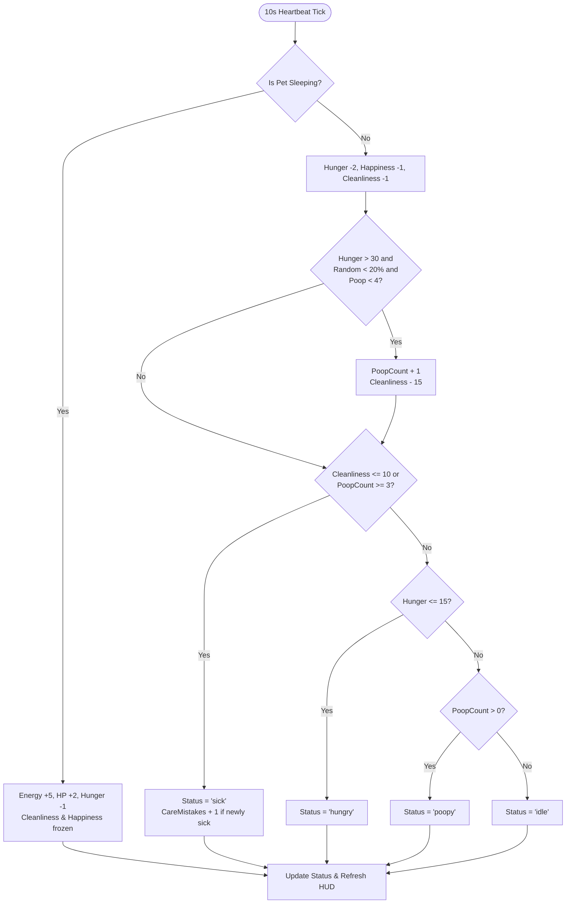
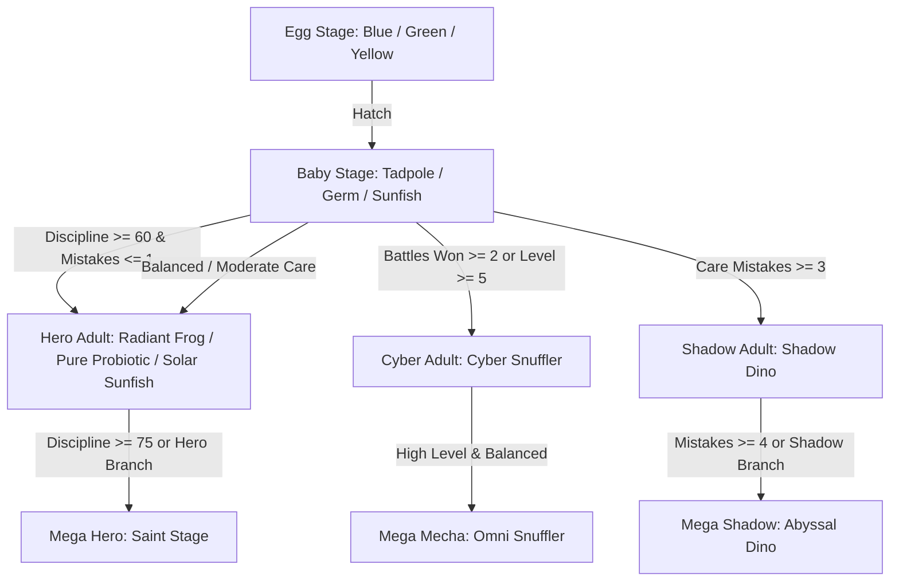

# They Might Byte: Modernized Virtual Pet Digivice Simulator
## Comprehensive Game Design Document (GDD) & Systems Architecture
**Version:** 2.0.0  
**Target Engine:** Phaser 3.88+ / TypeScript / Vite  
**Platform:** Web (HTML5 / Desktop & Mobile Browsers / Itch.io)  
**Author:** Ryan Guthrie & Antigravity  

---

## 1. Executive Summary & Design Pillars

### 1.1 High Concept
*They Might Byte* is a retro-authentic virtual pet (V-Pet) simulator inspired by 1997 Digimon Digital Monsters and Bandai Tamagotchi devices, modernized with deep Mendelian genetics, a branching procedural evolution matrix, a tactical turn-based Colosseum gauntlet, pluggable arcade training minigames, and a gamified Cyber Focus (Pomodoro) productivity companion.

### 1.2 Core Pillars
1. **Tactile Hardware Nostalgia**: Authentic virtual pet form factor—a physical handheld digivice shell with 3-button actuation, audible piezoelectric buzzer beeps, multiple collectible plastic chassis themes, and real-time switchable LCD dot-matrix glass filters.
2. **Deep Procedural Genetics & Lineage**: Every pet possesses an individualized 124-point IV genome, Mendelian chromosome crossover, visible phenotypic color/scale mutations, and cryptographic lineage seals that persist across generations.
3. **Meaningful Branching Metamorphosis**: Evolution is not a straight line. Care mistakes, discipline adherence, battle combat record, and training regimen diverge a tiny tadpole or germ into Radiant Heroes, Abyssal Shadows, or Overclocked Mecha Snufflers.
4. **Symbiotic Daily Flow**: Beyond idle caretaking, the companion supports real-world focus sprints, rewarding Tamers with discipline, rare tokens, and empathetic cognitive restoration insights.

---

## 2. Hardware Digivice Shell & Display Architecture

### 2.1 Virtual Hardware Form Factor
The game simulates a dedicated physical handheld device rendered on an 800x800 canvas:
- **Active LCD Display Area**: Exactly $400 \times 400$ pixels, centered at $(x=200, y=200)$ to $(x=600, y=600)$, clipped via hardware `GeometryMask`.
- **Hardware Shell Chassis**: Layered around the LCD screen at depth 0 (background shell bezel) and depth 20 (top frame and interactive hardware buttons).
- **Physical Controls**:
  - **Button 1 (Left / Top)**: Navigate Up / Previous / Item Quick-Use / Stat Inspect.
  - **Button 2 (Center / Circle)**: Confirm / Execute / Interact / Power-On.
  - **Button 3 (Right / Bottom)**: Navigate Down / Next / Cancel / Back / Flee.

```
       [ 1997 DIGIVICE HANDHELD CASING ]
   +---------------------------------------+
   |             [ POWER LED ]             |
   |   +-------------------------------+   |
   |   |  LCD SCREEN (400 x 400 px)    |   |
   |   |  - Scanline / Dot-Matrix Grid |   |
   |   |  - Status HUD & Care Icons    |   |
   |   |  - Animated Pet Entity (Mask) |   |
   |   |  - Scrollable Viewport Menus  |   |
   |   +-------------------------------+   |
   |                                       |
   |     (BTN 1)       (BTN 2)    (BTN 3)  |
   |     [ LEFT ]     [ ENTER ]   [ RIGHT] |
   +---------------------------------------+
```

### 2.2 Ergonomic Control Schemes
To bridge classic 3-button hardware and modern PC/mobile interfaces, inputs are unified into an event bus:
- **Keyboard Navigation**:
  - `▲` / `▼` or `W` / `S`: Up/Down navigation (scroll menus item-by-item).
  - `◀` / `▶` or `A` / `D`: Left/Right navigation (cycle tabs: Items &rarr; Actions &rarr; Battle).
  - `ENTER` / `SPACE` / `Z`: Confirm / Execute selected action.
  - `ESC` / `X`: Cancel / Back / Close menu.
  - `1`, `2`, `3`: Direct hardware button trigger (with physical button depression animations).
  - `F`: Instant cycle LCD Glass Filter.
  - `M`: Toggle Sound & BGM Mute.
- **Mouse & Touch**: Direct click/tap on on-screen hardware buttons, LCD viewport menu rows, or the pet itself.

### 2.3 Retro LCD Filter Pipeline
Rendered directly over the LCD viewport (depth 28, masked to $400 \times 400$):
1. **Clear Modern LCD**: Crisp pixel art with zero post-processing.
2. **1997 Dot-Matrix**: Authentic $3 \times 3$ pixel phosphor grid with faint LCD green tint (`#0d381e`), simulating original STN liquid crystal panels.
3. **Cyber Scanlines**: High-contrast CRT scanlines with cyan chromatic flare (`#38bdf8`).
4. **Warm Amber CRT**: Phosphor amber terminal warmth (`#f59e0b`) with horizontal beam gaps.

---

## 3. Core Simulation & Caretaking Systems

### 3.1 Stat Dimensions & Bounds
Every pet model maintains the following primary care parameters:

| Stat | Range | Default | Decay Rate (Awake) | Decay Rate (Sleeping) | Impact on Gameplay |
| :--- | :--- | :--- | :--- | :--- | :--- |
| **Hunger** | 0 – 100 | 80 | -2 every 10s (-12/min) | -1 every 10s (-6/min) | $\le 15$ triggers 'hungry' alert; 0 causes health decay. |
| **Happiness** | 0 – 100 | 50 | -1 every 10s (-6/min) | 0 | Affects evolution path; drops when neglected or disciplined improperly. |
| **Cleanliness** | 0 – 100 | 100 | -1 every 10s (-6/min) | 0 | Drops by -15 per poop drop; $\le 10$ triggers sickness. |
| **Energy** | 0 – 100 | 90 | Drained by battles & minigames (-15 to -20) | +5 every 10s (+30/min) | Required to train, battle, and sprint. Restored via sleep. |
| **Discipline** | 0 – 100 | 70 | Static (adjusted via training & cheer) | Static | $\ge 60$ required for Hero evolution; boosted via Memory Matrix & Focus. |
| **Care Mistakes**| 0 – 99 | 0 | Increments on unaddressed critical status | Static | Critical branching metric ($\ge 3$ triggers Shadow evolution). |
| **Poop Count** | 0 – 4 | 0 | Chance if fed & awake: 20% every 10s | 0% | $\ge 3$ poops triggers instant sickness; flushes via Bath action. |

### 3.2 Real-Time Stat Tick Loop
The internal heartbeat fires every 10,000 ms (10 seconds) during active play:


### 3.3 Caretaker Actions & Interactions
- **Feed Quick Snack**: Restores +20 Hunger (free).
- **Administer Medicine**: Cures sickness, resets status to `idle`, restores HP to Max.
- **Bath & Flush Poop**: Clears all poop entities, restores Cleanliness to 100%.
- **Pet & Cheer**: Plays spring bounce animation, increases Happiness (+20) and Discipline (+2).
- **Lights Out (Sleep Mode)**: Dims viewport with dark overlay ($75\%$ slate), halts hygiene decay, doubles energy recovery, and slowly recovers hit points.
- **Interactive Poking / Tapping**: Direct clicks on the pet sprite trigger squash-and-stretch spring tweens with dynamic speech bubbles reflecting genetic traits, hunger, mood, and health.

---

## 4. Deep Genetics & Hereditary Engine

### 4.1 Chromosome Loci ($124$-Point System)
Every pet is instantiated with a deterministic `PetGenotype` containing 13 distinct genetic loci:

```typescript
export interface ChromosomeLoci {
  // Physical / Cosmetic
  colorHue: number;          // 0–360° HSV hue
  auraTint: number;          // 0xRRGGBB computed hex
  scaleModifier: number;     // 0.85 to 1.25 physical size multiplier
  patternDensity: number;    // 0 to 100 skin pattern density

  // Metabolic
  metabolicEfficiency: number; // 0.8 to 1.3 (modulates hunger decay)
  energyRecoveryRate: number;  // 0.8 to 1.3 (modulates sleep recovery)
  sicknessResistance: number;  // 20 to 100 (resists contagion)

  // Cognitive / Behavioral
  focusAffinity: number;       // Multiplier on Pomodoro rewards
  disciplineTendency: number;  // Baseline discipline adherence
  curiosityGene: number;       // Screen wandering frequency

  // Combat Individual Values (IVs: 0 to 31)
  ivHp: number;                // 0–31
  ivAttack: number;            // 0–31
  ivDefense: number;           // 0–31
  ivSpeed: number;             // 0–31
}
```

### 4.2 Phenotype Evaluation & Ranks
Total IV is calculated as:
$$\text{IV}_{\text{Total}} = \text{ivHp} + \text{ivAttack} + \text{ivDefense} + \text{ivSpeed} \quad (\text{Max } 124)$$

- **S-Rank**: $\text{IV}_{\text{Total}} \ge 100$ (Golden aura, pristine stat curves)
- **A-Rank**: $80 \le \text{IV}_{\text{Total}} < 100$
- **B-Rank**: $60 \le \text{IV}_{\text{Total}} < 80$
- **C-Rank**: $\text{IV}_{\text{Total}} < 60$

### 4.3 Genetic Mutations
Rare alleles ($25\%$ baseline generation chance, $12\%$ mutation rate during crossover):
- `Bioluminescent`: Glowing pulsating aura tint in dark environments.
- `Titan`: Permanent $+22\%$ sprite scale expansion and boosted base HP.
- `Armored`: Visual hardened chitin outline; permanent $+15\%$ defense mitigation.
- `Cybernetic`: Overclocked neon scanline trail; $+20\%$ SP generation in battle.
- `Pyre`: Fiery chromatic aura; attack damage variance $+30\%$.
- `Zen`: Triples discipline gain from focus companion sprints.
- `GlitchShift`: Visual pixel chromatic aberration; chance to evade attacks.

### 4.4 Mendelian Crossover Algorithm
When ascending or breeding, offspring inherit chromosomes through allele crossover:
1. Each locus randomly inherits from Parent A or Parent B ($50/50$ probability).
2. Allele drift mutation: $12\%$ probability to drift by $\pm 5\%\text{--}15\%$.
3. Mutation inheritance: Unique parent mutations pool together with a chance of spontaneous novel mutation.
4. DNA barcode hash generated: e.g. `DNA-7F2A-B904-C811`.

---

## 5. Branching Metamorphosis & Evolution Matrix

### 5.1 Evolution Tree Hierarchy
Evolution progresses across 4 lifecycle stages: **Egg** &rarr; **Baby** &rarr; **Adult** &rarr; **Mega / Ascended**.



### 5.2 Branch Evolution Matrix

| Current Stage | Target Form | Branch | Prerequisites | Stat Bonuses |
| :--- | :--- | :--- | :--- | :--- |
| **Egg (Blue)** | Cute Tadpole | Neutral | Hatch Action | HP +10, ATK +3, DEF +2 |
| **Egg (Green)** | Baby Germ | Neutral | Hatch Action | HP +10, ATK +3, DEF +2 |
| **Egg (Yellow)** | Tiny Sunfish | Neutral | Hatch Action | HP +10, ATK +3, DEF +2 |
| **Baby** | Radiant Frog / Probiotic | **Hero** | Discipline $\ge 60$ & Mistakes $\le 1$ | HP +25, ATK +8, DEF +10 |
| **Baby** | Cyber Snuffler | **Cyber** | Battles Won $\ge 2$ or Level $\ge 5$ | HP +30, ATK +15, DEF +8 |
| **Baby** | Shadow Dino | **Shadow** | Care Mistakes $\ge 3$ | HP +20, ATK +18, DEF +4 |
| **Adult (Hero)** | Saint Form | **Mega Hero** | Discipline $\ge 75$ or Hero Path | HP +50, ATK +20, DEF +25 |
| **Adult (Shadow)**| Abyssal Dino | **Mega Shadow**| Care Mistakes $\ge 4$ or Shadow Path | HP +40, ATK +35, DEF +15 |
| **Adult (Cyber)** | Omni Snuffler | **Cyber Mecha**| Balanced High Level | HP +45, ATK +28, DEF +20 |

---

## 6. Mini-Game Arcade & Stat Training Architecture

The minigame engine utilizes a decoupled plugin registry (`MiniGameRegistry`), allowing hot-pluggable gameplay modes.

```
                  +----------------------+
                  |   MiniGameRegistry   |
                  +----------+-----------+
                             |
         +-------------------+-------------------+
         |                   |                   |
+--------v---------+ +-------v--------+ +--------v---------+
| DigiWorkoutPlugin| |DigiCrawlerPlugin| |MemoryMatrixPlugin|
| (Reflex / ATK)   | | (Dungeon / DEF)| | (Puzzle / DISCIP) |
+------------------+ +----------------+ +-------------------+
```

### 6.1 Game 1: Digi-Workout (Reflex & Timing)
- **Concept**: A high-speed power gauge bounces back and forth across a target strike zone.
- **Trained Stat**: **Attack** (+1 ATK per hit).
- **Controls**: Button 2 / Spacebar in green target window ($375\text{--}425\text{ px}$).
- **Pacing**: 3 rounds. Speed accelerates each round from $260\text{ px/s}$ to $380\text{ px/s}$.
- **Rewards**: $25\text{ XP} \times \text{Hits}$, $\text{Coins} = \text{Hits} \times 3 + 2$.

### 6.2 Game 2: Digi-Crawler (Dungeon Exploration)
- **Concept**: 5-floor subterranean cyber dungeon crawl. Players choose between 3 mystery gates on each floor.
- **Gate Types**:
  - `Monster Skirmish`: Combat fight (+5 coins, +1 battle win).
  - `Data Cache`: Treasure vault (+8 to +13 coins).
  - `Nano Pool`: Health & energy restorative bath.
  - `Warp Portal`: Safe descent elevator.
- **Trained Stat**: **Defense** (+2 base + 1 per skirmish won).
- **Rewards**: Floor depth $\times 30\text{ XP}$, total accumulated coins + 10 completion bounty.

### 6.3 Game 3: Memory Matrix (Cyber Pattern Recall)
- **Concept**: Simon-style audio-visual sequence recall across 3 holographic pads.
- **Trained Stat**: **Discipline** (+5% per completed round).
- **Pacing**: Round 1 (3 steps), Round 2 (4 steps), Round 3 (5 steps).
- **Rewards**: $+4\text{ Coins}$ per round, $+30\text{ XP}$ per round.

---

## 7. Colosseum Gauntlet Combat System

### 7.1 Gauntlet Structure
The battle arena pits the player pet against a sequential 3-stage gauntlet:
- **Stage 1**: Wild Minor Glitch (Base HP: 32, ATK: 7)
- **Stage 2**: Frost Elite Glitch (Base HP: 44, ATK: 10, Cyan Tint)
- **Stage 3**: Flame Titan Boss (Base HP: 81, ATK: 13, Red Boss Tint)

### 7.2 Damage & SP Combat Formulas
- **Standard Strike**:
  $$\text{Damage} = \lfloor (\text{PlayerAttack} + \text{rand}(-1, 3)) \times \text{CritMultiplier} \rfloor$$
  - Base Critical Hit chance: $22\%$. Critical Multiplier: $1.4\times$.
  - Charges $+25\%$ Special Points (SP).
- **Mega Finisher (Special Ability)**:
  - Requires $\ge 50\%$ SP.
  - Guaranteed Critical Strike:
  $$\text{Damage} = \lfloor (\text{PlayerAttack} \times 2.2 + \text{rand}(3, 8)) \times 1.4 \rfloor$$
  - Heavy screen shake ($0.02$ amplitude) and sound surge.

### 7.3 Champion Rewards & Rare Boss Loot
Defeating the Stage 3 Boss awards:
- $+25$ Coins.
- Level Up (+1 Level, +3 Attack, +5 Max HP, +30 Happiness).
- **Rare Loot Drop** (Deposited directly into player inventory):
  - *Mega Protein Shake*: Permanent +2 ATK, +1 DEF, +5 Discipline.
  - *Titan Bracer*: Permanent +5 Max HP, +2 DEF, +10 Discipline.
  - *Golden Digi-Apple*: +50 Hunger, +60 Happiness, +50 Energy, Instant Cure Sick.

---

## 8. Cyber Focus Pomodoro Companion

### 8.1 Productivity Integration
The Focus Companion converts real-world work sessions into in-game growth:
- **Duration Tiers**:
  - `15m Sprint` &rarr; 3 Focus Tokens
  - `25m Pomodoro` &rarr; 5 Focus Tokens
  - `45m Deep Flow` &rarr; 9 Focus Tokens
  - `30s Fast Demo` &rarr; 1 Focus Token (Testing mode)
- **Visual Feedback**: The companion enters a levitating meditation loop tinted by its genetic aura. A smooth green progress bar tracks remaining time.
- **Rewards**:
  - Currency: $+2\text{ Coins}$ per token.
  - Pet Growth: $+15\text{ Happiness}$, $+5\text{ Discipline}$, $+N\text{ Focus Minutes}$ logged on permanent profile.
  - Empathetic Rest Guidance: Quotes and ergonomic rest guidance chimes.

---

## 9. In-Game Economy & Item Catalog

### 9.1 Sources & Sinks Model
- **Coin Inflows**:
  - Colosseum Victory: $+25\text{ Coins}$
  - Digi-Crawler Dungeon: $+15\text{ to } +25\text{ Coins}$
  - Digi-Workout: $+5\text{ to } +11\text{ Coins}$
  - Memory Matrix: $+6\text{ to } +14\text{ Coins}$
  - Cyber Focus Sprint: $+6\text{ to } +18\text{ Coins}$
  - Hall of Fame Rebirth Bounty: $+20\text{ Coins}$
- **Coin Sinks**:
  - Digi-Shop consumables and permanent training gear.

### 9.2 Complete Shop Catalog

| Item ID | Item Name | Cost | Effects & Bonuses | Strategic Purpose |
| :--- | :--- | :--- | :--- | :--- |
| `parsnip` | Parsnip | 🪙2 | Hunger +25, Energy +15, Clean +5 | Cheap sustenance |
| `candy-cane` | Candy Cane | 🪙3 | Hunger +15, Happiness +25, Energy +25 | Quick energy & mood fix |
| `cyber-meat` | Prime Dino Ribs | 🪙4 | Hunger +45, Happiness +15, Energy +15 | Premium high-satiety meal |
| `cake` | Cake | 🪙5 | Hunger +30, Happiness +40, Energy +20 | Celebration / mood recovery |
| `protein-shake`| Mega Protein Shake| 🪙6 | Hunger +20, ATK +2, DEF +1, DIS +5 | Permanent early combat training |
| `medicine` | Vaccine Spray | 🪙8 | Cure Sickness, Cleanliness +50 | Mandatory medical care |
| `power-bracer` | Titan Bracer | 🪙12 | Max HP +5, ATK +2, DEF +2, DIS +10 | Permanent tank stat buff |
| `golden-apple` | Golden Digi-Apple | 🪙14 | Hunger +50, Happy +60, Energy +50, Cure Sick | Ultimate miracle elixir |

---

## 10. Social, Lineage & Cryptographic Anti-Tamper Engine

### 10.1 Cryptographic Seal Hashing (`cryptoSeal.ts`)
To prevent client-side state manipulation when sharing or exporting pets, every pet profile is stamped with an anti-tamper cryptographic signature:
- Canonical payload concatenates ID, Stage, Level, Stats, Generation, Battles Won, DNA Hash, and IVs.
- 64-bit dual-state FNV-1a hash generated with internal salt: `SEAL-XXXXXXXXXXXX`.
- Rejects tampered payloads during lobby loading or URL import.

### 10.2 Tamer Card PNG Generator (`cardExport.ts`)
- Dynamically renders a $400 \times 600$ collectible digital trading card to an off-screen HTML5 Canvas.
- Extracts live Phaser texture cache sprite, applies active genetic aura tints, renders DNA barcode stripes, holographic badge borders, and IV stat radar bars.
- Triggers instant client-side PNG download (`TamerCard-<Name>.png`).

### 10.3 Global Tamer Showcase (`VisitorArenaScene.ts`)
- Asynchronous local/remote client interface simulating global Tamers.
- Inspect other players' IV ranks, generation numbers, and DNA hashes.
- Engage in sparring duels with visitor teams.

---

## 11. Hall of Fame & Generational Prestige Loop

When an adult pet reaches Level 3+ or achieves Adult/Mega stage, Tamers can choose to **Ascend to the Hall of Fame**:
1. Current pet is permanently immortalized in the Hall of Fame ledger with battle records, focus hours, and generation rank.
2. Rebirth grants a $+20\text{ Coin}$ inheritance bonus.
3. Generational Egg hatches with **Inherited Heirloom Bonuses**:
   - Starting HP $+5$ permanent baseline increase.
   - Starting Attack $+1$ baseline increase.
   - Starting Defense $+1$ baseline increase.
   - Starting Discipline $+10$ bonus (starts at 80 instead of 70).
   - Offspring genome generated via Mendelian crossover between the retired champion and the Ether Gene Pool.

---

# PART II: Game Designer Systems Review & Balancing Audit

### Conducted by: Lead Systems & Economy Game Designer

---

## 1. Executive Evaluation: What Works Brilliantly

1. **Nostalgia Execution & Tactile Response**:
   The 3-button hardware shell, click depressions, scanline LCD shaders, and spring bounce animations immediately place the player in the 1997 Bandai/Digimon headspace while running smoothly in modern browsers.
2. **Genetics & Visible Phenotypes**:
   Having $124$-point IVs, chromosomal hues, scale modifiers, and mutation badges directly impact in-game sprites, combat performance, and exported trading cards is a massive differentiator over static Tamagotchi clones.
3. **Multi-Disciplinary Core Loop**:
   Pairing Tamagotchi survival with Pomodoro focus sprints creates a natural real-world anchor. Tamers keep the tab open while working, glancing over to feed or clean their digital companion.

---

## 2. Critical Friction Points & Balance Gaps

### 2.1 The Hunger / Sickness Decay Clock is Too Fast for Passive Play
- **The Issue**: Currently, Hunger decays by $-2$ every 10 seconds. From 100% full, a pet will starve to 0% in **8 minutes and 20 seconds**. If a player steps away for a short meeting without toggling Sleep mode, their pet will poop 3 times, contract a disease, accumulate 2 care mistakes, and potentially die or derail its evolution path.
- **The Impact**: Players may feel anxious rather than delighted, or simply close the tab to avoid killing their pet.
- **Recommended Fix**:
  - Scale active hunger decay to $-1$ every 30 seconds (50 minutes to starve).
  - Add an "Autopilot Daycare" or "Snack Bowl" item that automatically feeds up to 3 snacks while unattended.

### 2.2 Offline Simulation Gap (Catch-Up Calculation)
- **The Issue**: Stat decay is driven by `Phaser.Time.TimerEvent` in `PetScene.ts`. When the tab is closed, the game freezes in time. When the player re-opens it 16 hours later, the pet is in the exact same state as when they left.
- **The Impact**: While this prevents off-screen pet death, it undermines the feeling of a living virtual creature that sleeps through the night and wakes up in the morning.
- **Recommended Fix**: Implement an **Offline Delta Processor** on boot in `StorageService`:
  ```typescript
  const deltaMs = Date.now() - pet.stats.timers.lastTick;
  // Cap offline simulation at 8 hours maximum to prevent unavoidable death
  const simMs = Math.min(deltaMs, 8 * 3600 * 1000);
  applyOfflineMetabolism(simMs, pet.isSleeping);
  ```

### 2.3 Evolution Triggering Lacks Anticipation
- **The Issue**: In the current build, evolution is triggered instantly via an Action Menu item (`✨ Branch Evolution`). As long as criteria are met, the player can click the button repeatedly to skip through stages.
- **The Impact**: Evolution feels like a menu button rather than an organic, earned milestone of attentive care.
- **Recommended Fix**:
  - Tie evolution to pet age (`timers.lived >= 24 hours`) or battle experience thresholds.
  - Display an "Evolution Call" alert (flashing LED light and classic buzzer alert) when the pet is ready to cocoon and metamorphose.

### 2.4 Digi-Crawler Gate Decisions are Pure RNG
- **The Issue**: In `DigiCrawlerPlugin.ts`, the player chooses Door 1, 2, or 3, but the door contents are concealed under `[?]` until clicked.
- **The Impact**: The player makes a random guess rather than a strategic decision.
- **Recommended Fix**:
  - Reveal partial radar hints: e.g., "Door 1: Faint heartbeats detected", "Door 2: High metallic density", "Door 3: Chemical scent".
  - Allow the pet's `Curiosity` and `Speed` IVs to reveal gate contents in advance.

### 2.5 Economy Inflation vs Sinks
- **The Issue**: A single Colosseum run awards 🪙25 plus rare loot. A 25-minute Pomodoro awards 🪙10. Meanwhile, the most expensive shop item is 🪙14. Within two play sessions, a player can accumulate 🪙200+ with nothing left to purchase.
- **The Impact**: Money loses its value, removing motivation to grind minigames or defeat Colosseum bosses.
- **Recommended Sinks**:
  - **Cosmetic Shell Purchases**: Unlockable metallic or transparent casing themes in the shop for 🪙75–🪙150.
  - **Habitat Decorations**: Background themes for the LCD screen (Cyber Dojo, Volcanic Matrix, Neon City) for 🪙50–🪙100.
  - **Evolution Catalyst Stones**: Items that force specific mutation alleles for 🪙80.

---

## 3. Pacing & Progression Roadmap

### Day 1: Hatching, Bonding & First Steps
- **Hour 0.0**: Hatch chosen Starter Egg (Blue Aqua, Green Bio, or Yellow Solar). First genetic sequencing and IV discovery.
- **Hour 0.5**: Complete first Digi-Workout session, earning early Attack bonuses.
- **Hour 1.0**: Complete first 25-minute Cyber Focus session while working. Companion reaches Level 2.
- **Hour 2.0**: Enter Colosseum Gauntlet Stage 1.

### Day 2: Branching Metamorphosis & Colosseum Mastery
- **Hour 12–24**: Evolution trigger alerts player. Attentive care yields **Hero Radiant Frog**, while neglect mutates into **Shadow Dino**.
- **Combat Loop**: Farm Colosseum Stage 2 and 3 for rare Titan Bracers and Mega Protein Shakes.
- **Arcade Mastery**: Complete Floor B5 of Digi-Crawler, buffing defense to survive Boss Flame attacks.

### Day 3+: Mega Ascension, Pedigree & Lineage Prestige
- Pet reaches Level 5+ in Adult form and ascends to **Mega Hero** (Saint) or **Mega Shadow** (Abyssal).
- Export customized holographic Tamer Card PNG to share on social channels.
- Enter the **Hall of Fame**: Ascend the champion to immortal status.
- Hatch **Generation 2 Heirloom Egg** with inherited baseline stat perks (+5 HP, +1 ATK, +1 DEF, +10 DIS) and crossover mutation traits.

---

## 4. Systems Balance Summary Matrix

| System | Current State | Target Balanced State | Status |
| :--- | :--- | :--- | :--- |
| **Stat Decay Rate** | 30s tick (-2 hunger/min awake, -0.6 sleeping) | 30s tick + Daycare Snack Bowl auto-feeder | **Implemented** |
| **Evolution Agency** | Gated by Level, Battles, Focus & Life Timer | Metamorphosis Ceremony + Anticipatory Flash | **Implemented** |
| **Offline Progression**| 8-hour capped offline delta processor on boot | Auto-recovers sleeping pets & consumes Daycare Bowls | **Implemented** |
| **Economy Sinks** | Sinks up to 🪙75 (Shells, Gene Catalyst, Equipment) | Collectible shell chassis (Dragon Blood, Gold, Bronze) | **Implemented** |
| **Dungeon Arcade** | Disabled pending dedicated rework sprint | Digi-Workout & Memory Matrix active in arcade | **Implemented** |
| **Colosseum Rewards** | 🪙25 + Level Up + Rare Loot (Bracer, Shake, Apple) | Balanced against expanded shop prices | **Implemented** |

---

# PART III: Product Strategy, Platform Packaging & Market Fit Analysis

---

## 1. Market Opportunity & Target Audience

### 1.1 The Convergence of Nostalgia & Cozy Productivity
In recent years, the intersection of **retro virtual pets** and **passive/cozy desktop software** has evolved from a niche hobby into a commercially proven subgenre. Millions of players seek companions that enhance their daily workflow without demanding high-stress, full-screen commitment.

### 1.2 Target Audience Personas

1. **The 90s/2000s Nostalgia Purist (Ages 25–40)**:
   - Grew up with 1997 Digimon Digital Monsters, Tamagotchi, and *Pokemon Red/Blue*.
   - Craves authentic hardware aesthetics: 3-button actuation, audible piezo buzzer sounds, and dot-matrix LCD phosphor grids.
   - Values deep, mechanical systems (Mendelian genetics, IV stats, branching evolutions) over simplistic mobile clickers.
2. **The "Cozy Productivity" Remote Worker (Ages 20–35)**:
   - Programmers, designers, writers, and students spending 6–10 hours a day in front of screens.
   - Uses Pomodoro timers and lo-fi audio to sustain flow state.
   - Wants a low-friction desk buddy that thrives alongside their workday, rewarding them for completing real-world focus sprints.
3. **The Monster Breeder / Lineage Collector**:
   - Enthusiasts of *Pokemon* IV breeding, *Cassette Beasts*, and *Dragon Quest Monsters*.
   - Highly motivated by pedigree charts, Hall of Fame memorialization, gene mutation chasing (`Titan`, `Zen`, `Pyre`), and sharing collectible trading cards.

---

## 2. Competitive Landscape & Commercial Comps

| Title | Platform | Commercial Trajectory & Model | Relevance to *They Might Byte* |
| :--- | :--- | :--- | :--- |
| **Rusty's Retirement** | Steam (PC) | $2.5M+ revenue, 250k+ copies sold in 2024. Desktop bottom-bar idle game. | Proves desktop-docked companions running unobtrusively during work are a massive commercial hit. |
| **VPet-Simulator** | Steam (PC) | Viral hit, 95% Overwhelmingly Positive, 20k+ peak concurrent desktop players. | Confirms global hunger for interactive virtual pets living on the player's desktop. |
| **Digimon Vital Bracelet** | Dedicated Bandai Hardware | Multi-million unit physical wearable line linking steps/exercise to monster evolution. | Validates that tying real-world human habits (activity/focus) to monster growth is inherently addictive. |
| **Spirit City: Lofi Sessions** | Steam (PC) | 100k+ sales in launch months. Gamified Pomodoro timer with pets and ambient sound. | Demonstrates that knowledge workers happily pay $10–$15 for gamified productivity tools. |
| **Habitica / Finch** | Mobile / Web | Multi-million user habit trackers. | Validates long-term retention of RPG caretaking loops. |

### *They Might Byte*'s Competitive Moat:
Unlike purely aesthetic desktop pets or generic habit trackers, *They Might Byte* delivers **hardware-authentic LCD simulation**, **uncompromising Mendelian genetics with 124-point IVs**, a **tactical Colosseum battle gauntlet**, and **100% offline-first autonomy with zero predatory monetization**.

---

## 3. Platform Architecture & Packaging Strategy

```
                          [ Phaser 3 / TS Core Engine ]
                                       |
          +----------------------------+----------------------------+
          |                            |                            |
  [ Web-First PWA ]           [ Desktop Wrapper ]          [ Community / Social ]
  - Cloudflare Pages          - Tauri (Steam/Itch)         - Discord Activity
  - Zero-install instant      - Micro binary (<15MB)       - In-voice sparring
  - Mobile Home Screen app    - Dual Modes: Digivice /     - Trading card sharing
  - Service Worker offline      Docked Desktop Overlay
```

### 3.1 Tier 1: Web-First Progressive Web App (PWA) — *Primary Entry Point*
- **Rationale**: Immediate zero-friction access. Anyone with a URL can start raising a pet in under 2 seconds.
- **Implementation**:
  - Add standard Web App Manifest (`manifest.json`) with retro Digivice app icons.
  - Implement a lightweight Service Worker for full asset caching (`dist/` precaching).
  - Works 100% offline once visited.
  - On iOS and Android, tapping **"Add to Home Screen"** launches the game in standalone fullscreen mode without browser chrome, perfectly mimicking a physical handheld device.

### 3.2 Tier 2: Desktop Standalone & Overlay Mode (Steam / Itch Desktop via Tauri)
- **Why Tauri over Electron?**
  - **Memory Footprint**: Tauri utilizes the OS native WebView (WebKit on macOS, WebView2 on Windows) via Rust. Typical memory usage is **30–50 MB RAM**, compared to Electron's **250–400 MB RAM**. For a productivity companion meant to sit alongside IDEs and Figma, low RAM consumption is critical.
  - **Binary Size**: Packaged installers are **10–15 MB**, whereas Electron bundles exceed **120 MB**.
- **Dual Display Modes**:
  1. *Classic Digivice Window*: Standard 800x800 retro handheld casing.
  2. *Docked Desktop Companion (Overlay)*: Borderless, semi-transparent window that docks to the bottom edge or corner of the screen, staying "Always on Top" while the player works (directly capturing the *Rusty's Retirement* market).
- **Steam Integration**:
  - Steam Achievements (e.g. *"S-Rank Origin"*, *"Saint Ascension"*, *"100 Hours of Flow"*).
  - Steam Cloud Saves (seamless synchronization between desktop rig and laptop).

### 3.3 Tier 3: Discord Activity (Embedded App SDK)
- Discord now supports embedded web applications directly inside voice and text channels.
- *They Might Byte* can be packaged as a server activity, allowing community members to compare Tamer Cards, inspect each other's IV rankings, and run asynchronous sparring duels during study/coworking voice rooms.

### 3.4 Tier 4: Mobile Native (Capacitor Wrapper)
- Wrap the Vite build using **Capacitor** to deploy to Google Play and the Apple App Store.
- Enables native mobile hardware features:
  - Haptic feedback vibration on physical button depressions.
  - Local background notifications (*"Your pet is hungry!"*, *"Evolution Cocoon ready!"*).

---

## 4. Hosting & Infrastructure Architecture

### 4.1 Production Web Hosting: Cloudflare Pages
- **Recommendation**: Deploy the production web client to **Cloudflare Pages**.
- **Advantages**:
  - **Zero Cost**: Cloudflare Pages free tier includes unlimited bandwidth, automated Git deployments, and global edge CDN caching across 300+ cities.
  - **Performance**: Sub-50ms static asset delivery worldwide.
  - **Edge Workers**: Future multiplayer lobbies or global Hall of Fame leaderboards can run directly on Cloudflare Python/JS Workers without dedicated server maintenance.
  - **Custom Domain**: Instant SSL on custom apex domains (e.g., `theymightbyte.com` or `digivice.io`).

### 4.2 Indie Gaming Hub: Itch.io
- Deploy via the automated release pipeline (`pnpm run build:itch` &rarr; `they-might-byte-release.zip`).
- **Features**:
  - Direct in-browser HTML5 playable embed.
  - Community forums, devlog updates, and review ratings.
  - Tag visibility across `#virtual-pet`, `#tamagotchi`, `#retro`, `#digimon`, and `#productivity`.

---

## 5. Commercial Model & Monetization Ethics

### 5.1 Pricing Strategy
- **Web / Itch.io**:
  - 100% Free-to-play in browser.
  - "Name Your Own Price" option with a suggested $3.00–$5.00 tip jar for Tamers who want to support ongoing development.
- **Steam / Desktop**:
  - **Premium Single-Purchase: $4.99–$7.99 USD**.
  - Bundled with Desktop Overlay mode, Steam Cloud saves, Steam Achievements, and exclusive commemorative shell chassis.

### 5.2 Ethical Design Commitment (Anti-Pay-to-Win)
- **Zero Predatory Mechanics**: No gacha loot boxes, no paid stat boosters, no real-money energy refills, and no intrusive interstitial ads.
- **Player Respect**: Progression, rare mutations, and cosmetic shells are earned exclusively through genuine care, combat mastery, and real-world focus sprints.

---

*Document updated and verified for They Might Byte v2.0.*

